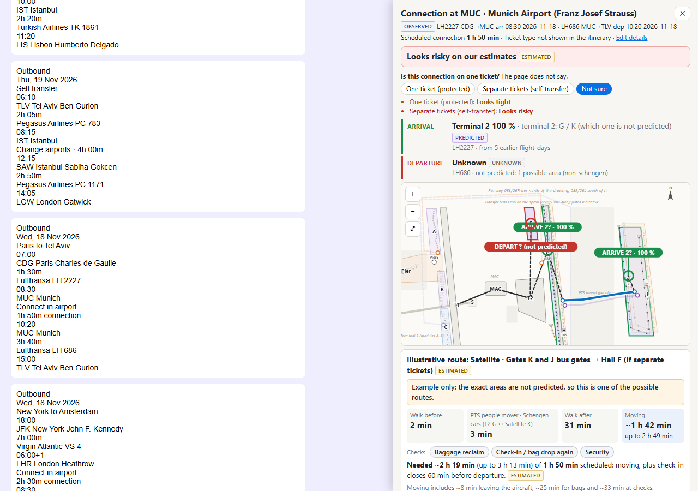
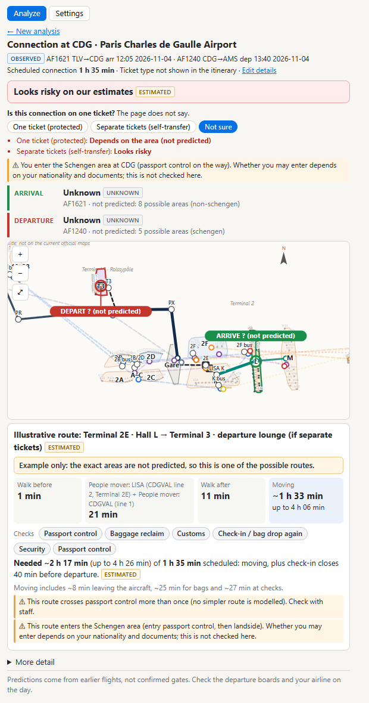
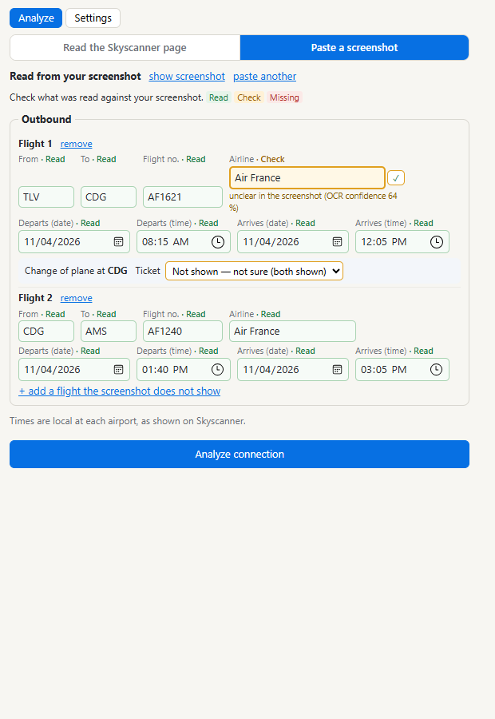

# Connections Analyst

**How long will my connection really take?** Connections Analyst is a Chrome extension. It reads a flight connection from a flight-search results page, or from a pasted screenshot of an itinerary. For eight large European hubs it shows:

- the **likely arrival and departure terminals and gate areas**, from the history of those flight numbers;
- a **schematic airport map** with the route between them (shuttles, passport and security checks, re-screening);
- an **indicative transfer time** and a verdict, always labelled *Observed*, *Predicted*, *Estimated* or *Unknown*.

**Airports:** Amsterdam (AMS), Paris-CDG (CDG), Rome-Fiumicino (FCO), Frankfurt (FRA), London Heathrow (LHR; terminal level only), Madrid (MAD), Munich (MUC) and Zürich (ZRH).

> **Status: working pilot for personal use.**
> - Not published in the Chrome Web Store.
> - The time estimates come from sourced assumptions and have **not yet been validated against timed real connections** (see [Limits](#limits)).
> - Never treat a verdict as a guarantee.

## Screenshots

The page behind the panel is the project's own test page (a mock-up of a results list), not a live flight-search site.



| Full result with map and transfer time | Screenshot mode: check what was read, then analyse |
|---|---|
|  |  |

## How it works

```
 flight-data provider (AeroDataBox)                     Chrome (Manifest V3 extension)
          │  3 scheduled slots a day per airport          ┌──────────────────────────────────────────┐
          ▼                                               │ content script: reads only the itinerary │
 ┌───────────────────────────┐   /fd-api/v1/connection    │ the user clicks (or OCR of a pasted image│
 │ collector + server        │ ◄───────────────────────── │ with local tesseract.js, nothing uploaded)│
 │ (Node, TypeScript)        │   127.0.0.1, bearer token  │            │                             │
 │  • scheduler, retries,    │ ─────────────────────────► │ resolver → router → timing → risk         │
 │    unit budget            │   per-flight terminal /    │            │                             │
 │  • PGlite (PostgreSQL)    │   gate-area distributions  │ panel: map, route, minutes, verdict       │
 │  • licence-safe retention │   + confidence             └──────────────────────────────────────────┘
 │  • backups, health,       │
 │    dashboard              │          airport models (airportmaps/data): areas, gate groups, controls,
 └───────────────────────────┘          shuttles and walks, every fact with its source
```

| Part | Folder | What it does |
|---|---|---|
| Extension | [`extension/`](extension/README.md) | MV3 extension: page parser, screenshot mode (local OCR), panel, settings |
| Decision engine | `extension/src/core/` | resolves gate areas, routes through the airport model, times each step, and gives an interval verdict (`risk.ts`, `timing.ts`) |
| Airport models | `airportmaps/` | schematic, sourced models of the airports, plus a map viewer (`npm run maps:dev`) and validators |
| Flight-data platform | `flightdata/` | scheduled collector, PGlite database, lookup API, health report and dashboard ([architecture](docs/FLIGHT_DATA_ARCHITECTURE.md), [lookup API](docs/FLIGHT_DATA_EXTENSION_API.md)) |
| Tests | `tests/` | Vitest suites for the engine, the parsers, the airport models and the flight-data platform, plus a browser end-to-end check of the real extension in Edge |

**Design rules the code enforces (with tests):**
- **Fail safe.** Missing or inconsistent dates, an overnight or DST change, an airport change or an unknown ticket type ends in "Not assessed", never in a confident wrong answer.
- **Evidence-level probabilities.** No percentage is shown for samples under 5 flight-days. Verdicts are intervals; tests prove that a longer connection never gets a worse verdict.
- **Every required screening has minutes.** A required screening never counts as 0 minutes, and a test fails if a new screening rule has no time class.
- **Licence-safe data.** Raw provider rows are rolled into monthly counters after 4 days (the provider's licence allows 7), and only counters are kept long-term.
- **Outage-aware collection.**
  - A failing source is not hammered.
  - A spent quota stops calls.
  - An offline PC (just woken from sleep) retries after 10 minutes instead of burning its attempts.
- **No scraping of the booking site.** The extension reads only the text the user clicks, sends only flight numbers, dates and the airport, and sends them only to the user's own server.

**Prediction accuracy, first back-test:** see [docs/PREDICTION_BACKTEST_2026-11-09.md](docs/PREDICTION_BACKTEST_2026-11-09.md).
- **Method:** one day held out, 60 flights per airport and direction.
- **Terminal:** 75–100 % correct.
- **Most likely gate area:** 71–96 % correct.
- **Caveat:** one day only, so not yet a validation.

## Quick start

Needs Node.js 22.13+ (tested on 24).

```bash
npm ci
npm test                 # all Vitest suites
npm run ext:build        # → extension/dist  (load it as an unpacked extension in Chrome or Edge)
```

**Optional: flight history.**
1. Copy `.env.example` to `.env`.
2. Set `FD_ADMIN_TOKEN`, your own AeroDataBox key (`FD_AERODATABOX_KEY`) and `FD_ASSIGNMENTS`.
3. Run `npm run fd:server`, which serves on `http://127.0.0.1:8790`.
4. In the extension settings, enter that address and the token.

Without a server, everything works except the history predictions, which show as *Unknown*. Windows scheduled-task scripts for unattended collection are in `flightdata/deploy/windows/`.

**Browser end-to-end check** (headless Edge, against a local fixture page, never the live site):
1. `node extension/scripts/screenshot-fixtures.mjs` renders the synthetic screenshot fixtures. They are not stored in the repository.
2. `npm run ext:build -- --test`
3. `npm run ext:e2e`

## Limits

- **Times are not yet validated.** No estimate has been compared with timed real connections.
- **The page parser is untested on real pages.** It has been tested on representative and synthetic fixtures only.
- **Gate areas depend on what the provider publishes.**
  - Predicted gate areas: FRA and AMS (both directions), and departures at MAD and ZRH.
  - Terminal only: CDG, FCO, MUC and LHR.
- **One machine.** The collector is designed for one always-on machine.

## What is not in this repository

The research behind the airport models stays private:
- source captures and screenshots;
- video and document evidence;
- field notes;
- the collected flight database.

The models here keep a reference to each source (`sources` in every `airport.json`), not the material itself. Some tests check that research evidence; they skip when it is absent.

## Sources and attribution

- **Map data:** © OpenStreetMap contributors (ODbL).
- **Airport codes and countries:** OurAirports (public domain).
- **Flight data:** AeroDataBox, under its licence. No provider data is stored in this repository.
- **Not affiliated:** this project is not affiliated with or endorsed by Skyscanner, AeroDataBox, any airport operator or any airline. Names are used only to identify the pages and data involved.

## Licence

- **Code:** [MIT](LICENSE).
- **Airport models** (`airportmaps/data/`): ODbL 1.0, because they contain facts derived from OpenStreetMap (see [LICENSE](LICENSE)).
